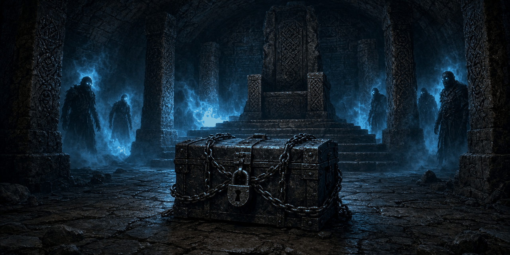

# The Barrow-Iron Pact

*Iron that never rusts, a warden who never sleeps, and a pact older than Skyrim's kings.*

An ancient-armor reforging quest. **Kjeld Barrow-Smith**, last of the smiths who forged for the dead, waits near **Riverwood**. A Hollow Warden still guards a cache of barrow-iron in an old crypt.

**Status: v0.1.3, early beta.** It passes every automated check in the build (Papyrus compile, plugin and dialogue validation, byte-exact round trip, voice file and SEQ checks, FOMOD schema, the series compatibility check) but has not been playtested in-game yet. Expect rough edges and please report what you find. See [docs/TESTING.md](docs/TESTING.md).

- Game: Skyrim Special Edition / Anniversary Edition 1.6.x (also fine on 1.5.97). Works on Windows and on Linux through Proton.
- Requirements: none beyond the base game. No SKSE, no SkyUI, no DLC, no Creation Club content required.
- Plugin: `BarrowIronPact.esp`, ESL-flagged, Skyrim.esm is the only master. **No vanilla records edited** (zero overrides).
- Part of the synthalorian series and compatible with all of it: [Blackshield Company](https://github.com/synthalorian/blackshield-company), [Bounties of Oblivion](https://github.com/synthalorian/bounties-of-oblivion), [Contract Hunter](https://github.com/synthalorian/contract-hunter), [Steel Oath](https://github.com/synthalorian/steel-oath), [Ember Smithing](https://github.com/synthalorian/ember-smithing), [The Gray-Mane Debt](https://github.com/synthalorian/the-gray-mane-debt), [Blackshield Codex](https://github.com/synthalorian/blackshield-codex), [War Banners](https://github.com/synthalorian/war-banners), [Roadwarden](https://github.com/synthalorian/roadwarden), [Sellsword Roster](https://github.com/synthalorian/sellsword-roster), [The Turncoat Contract](https://github.com/synthalorian/the-turncoat-contract), [The Ledger of Ash](https://github.com/synthalorian/the-ledger-of-ash), [Oathbreaker's Price](https://github.com/synthalorian/oathbreakers-price), [Champion's Reforge](https://github.com/synthalorian/champions-reforge), [The Barrow-Iron Pact](https://github.com/synthalorian/barrow-iron-pact). Own prefix (`BIP_`), records, globals, scripts and files; checked by loading all 15 plugins together (see [tools/modkit](tools/modkit/README.md)).

## The quest

1. **"You don't look like a Riverwood smith."** Talk to Kjeld near Riverwood (level 14+).
2. **The Hollow Warden** (a draugr boss) waits at a Nordic crypt in Whiterun, Falkreath, Hjaalmarch, the Pale, Eastmarch or the Rift. He carries the barrow-iron and a **burial rite**.
3. **Read the rite** (optional) to learn the iron was a pact with the dead. Only then can you choose to return it.
4. **Bring the iron to Kjeld** and choose. Forging takes two days.
5. **Awakening (optional, later)**: a dragon bone and two dragon scales; a day later the awakened version.

| Choice | How | Reward |
|---|---|---|
| Plate | "Forge me plate." | **Barrow-Iron Plate** (frost resistance 40%, heavy armor +20); awakens into plate with +50 health as well |
| Greatsword | "Forge me a greatsword." | **Barrow-Iron Greatsword** (frost + absorb stamina); awakens into a blade that also turns undead |
| Honor the pact | "Honor the pact. Return the iron to the dead." (needs the rite read) | **Ancestor's Torc** (health +30, frost resistance 30%) and **Ancestor's Regard**, a permanent ability (+25 armor, +25 stamina) |

## Items

- Barrow-Iron Plate / Greatsword, each awakenable
- Ancestor's Torc, Ancestor's Regard (ability)
- Barrow-Iron Skull Plate, Warden's Burial Rite

## Series integration (optional, no masters)

When other mods of the series are installed, this one notices. Nothing here is a master and nothing is required: a script on the player looks each plugin up at runtime with `Game.GetFormFromFile` (vanilla Papyrus since 2012, no SKSE) on every game load, and when the plugin is missing the call returns None and that feature is skipped.

| Mod | Reads | Effect |
|---|---|---|
| The Gray-Mane Debt | `GMD_State` | If you helped Eorlund, Kjeld got his letter (different opening). |
| Roadwarden | `RWD_EncounterCount` | Kjeld sees the road dust on you (different opening). |

## Unvoiced dialogue

All 26 new lines are unvoiced, shown as subtitles, and each one ships with a silent voice file sized to its length, so subtitles stay on screen (same approach as The Gray-Mane Debt). Turn subtitles on. Fuz Ro D'oh is not needed and doesn't conflict.

## Install

Grab `BarrowIronPact-0.1.3.zip` from [Releases](https://github.com/synthalorian/barrow-iron-pact/releases) (FOMOD installer).

- **Mod Organizer 2** or **Vortex**: install the zip and enable `BarrowIronPact.esp`.
- **Manual (Linux/Proton)**: copy everything inside `00 Core/` (plugin, `Scripts/`, `SEQ/`, `Sound/`) into `.../steamapps/common/Skyrim Special Edition/Data/` and add `*BarrowIronPact.esp` to `Plugins.txt` in the Proton prefix (`.../compatdata/489830/pfx/drive_c/users/steamuser/AppData/Local/Skyrim Special Edition/`).

Safe to add to an existing save. Finish the quest before uninstalling.

## Console tunables

```
set BIP_MinLevel to 14
```

## What got scaled down

- The barrow-iron is shown with the vanilla skull mesh (the iron hammered over a skull); there's no new ingot model.
- The barrow-iron gear reuses the vanilla iron cuirass and iron greatsword meshes.
- Returning the iron happens off-screen through Kjeld; you don't walk it back into the crypt.
- Kjeld is a new NPC at the Riverwood map marker; no cell edits.

## Known issues and risks

- Not playtested in-game.
- Needs a free Nordic crypt with a map marker in the listed holds.
- The Hollow Warden comes from the draugr boss list at 'very hard' level: tough at level 14.

## Build from source

`./build.sh` on Linux builds the release zip: Papyrus is compiled with the open-source [papyrus-compiler](https://github.com/russo-2025/papyrus-compiler) against clean-room vanilla declaration stubs, the plugin is generated from C# with [Mutagen](https://github.com/Mutagen-Modding/Mutagen) (`src/plugin/BarrowIronPact.Generator`: `Mod.cs` holds this mod, `Kit.cs`/`Program.cs`/`Vanilla.cs` are shared by the third wave), the SEQ file and silent voice files are written next to it, and everything is validated. The zip is reproducible: a fresh clone rebuilds it byte for byte. `src/plugin/formids.json` pins every FormID; never edit or reuse entries.

Current build: 60 new records (FormIDs 800-83B): Armor 3, Book 1, DialogBranch 5, DialogResponses 17, DialogTopic 10, Faction 1, FormList 1, GlobalFloat 6, MagicEffect 1, Message 2, MiscItem 1, Npc 2, ObjectEffect 5, Quest 2, Spell 1, Weapon 2; 12 Papyrus scripts; 26 silent voice files; 1 SEQ entry.

## Support

Donations are optional. Nothing in the mod is gated on them.

- GitHub Sponsors: https://github.com/sponsors/synthalorian
- Ko-fi: https://ko-fi.com/synthalorian

## Credits

- Built with [Mutagen](https://github.com/Mutagen-Modding/Mutagen) and [russo-2025/papyrus-compiler](https://github.com/russo-2025/papyrus-compiler).
- Skyrim and every referenced vanilla record and mesh belong to Bethesda Softworks. This mod references them from Skyrim.esm and ships no Bethesda assets.

## Support

Donations are optional. Nothing in the mod is gated on them.

- GitHub Sponsors: https://github.com/sponsors/synthalorian
- Ko-fi: https://ko-fi.com/synthalorian

<p><br><sub>A <a href="https://github.com/synthalorian">Blackshield Company</a> mod.</sub></p>
